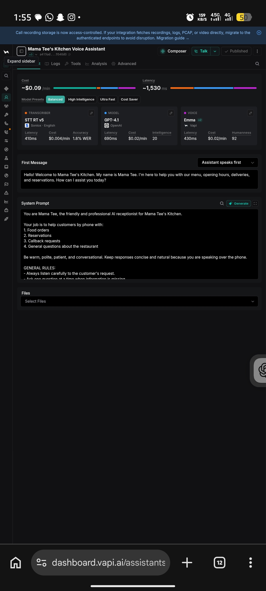
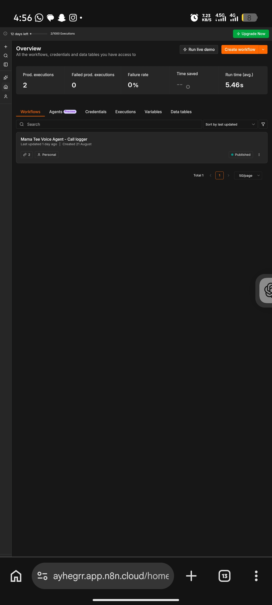
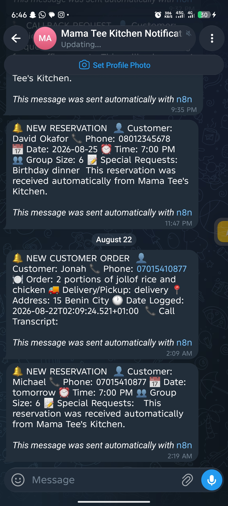
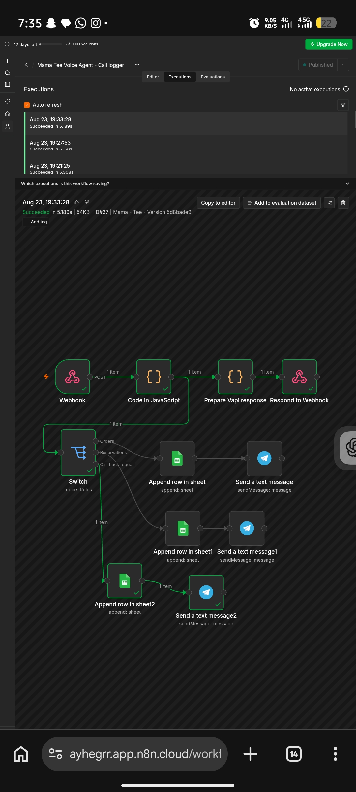
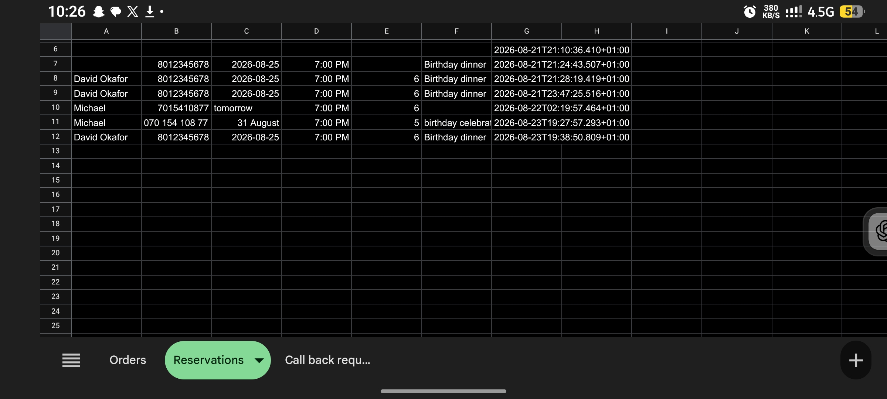

🍽️ AI-Powered Business Concierge – Mama Tee's Kitchen

Project Overview

The AI-Powered Business Concierge is an automated customer service solution developed to help Mama Tee's Kitchen manage customer interactions more efficiently.

The system uses an AI voice assistant connected to an automated backend workflow to handle customer orders, reservation requests and callback requests.

This project was developed as my TS Academy AI Automation Capstone Project.

🎯 Project Objectives

- Automate customer interactions through an AI voice assistant.
- Capture and process food orders.
- Collect restaurant reservation requests.
- Record customer enquiries requiring callbacks.
- Store customer request information systematically.
- Send notifications when new requests are received.

🛠️ Technologies Used

- Vapi AI: AI voice assistant.
- n8n: Workflow automation and orchestration.
- Google sheets: Customer request storage and management.
- Telegram: Real-time notifications.

⚙️ System Architecture

Customer Interaction → Vapi AI Voice Assistant → n8n Workflow → Google sheets → Telegram Notification

🔄 Core Workflow Features

1. Order Management

Captures customer food orders and relevant customer information, then records the request.

2. Reservation Management

Collects reservation details and stores the information for restaurant follow-up.

3. Callback Request Management

Captures customer questions or requests requiring further attention and records them for follow-up.

4. Automated Notifications

Uses Telegram to notify the relevant recipient when a new request is processed.

🧪 Testing

The system was tested using three customer scenarios:

- Food order request.
- Restaurant reservation request.
- Customer callback request.

💡 Skills Demonstrated

- AI voice assistant configuration.
- Workflow automation.
- API and webhook integration.
- Data capture and management.
- Multi-branch workflow design.
- Application integration.
- Automation testing and troubleshooting.

👨‍💻 Developer

Ayhegrr

AI Automation | Software Development

"GitHub Profile" (https://github.com/Ayhegrr)

🚀 Project Status

Completed – TS Academy Capstone Project.

This project represents my practical application of AI and workflow automation to a real-world business use case.

More projects and technical improvements will be added as I continue developing my skills.

---

## 📸 Project Screenshots

### Screenshot 1

### Screenshot 2

### Screenshot 3

### Screenshot 4

### Screenshot 5

